# TP Docker — Sécurisation d'image et de conteneur

> **Application :** quiz-docker — application web statique (Vite + nginx)  
> **Auteur :** lcgregorio93  
> **Date :** 2026-11-16  
> **Scanner CVE :** [Trivy](https://trivy.dev) 0.76 (via Docker, sans installation locale)

## Liens

| Ressource | URL |
|---|---|
| **Dépôt GitHub** | https://github.com/lcgregorio93/tp-docker-securisation |
| **Docker Hub** | https://hub.docker.com/r/lcgregorio93/quiz-docker |
| **Image initiale** | `lcgregorio93/quiz-docker:initial` |
| **Image sécurisée** | `lcgregorio93/quiz-docker:secure` |

---

## Prérequis

- Docker ≥ 24
- Bash ≥ 5
- Python 3 + Pillow (`pip install pillow`) — uniquement pour la génération des captures PNG
- curl

---

## Arborescence du dépôt

```
tp-docker-securisation/
├── README.md                   # ce fichier
├── commandes.md                # toutes les commandes copiables
├── app/                        # sources de l'application Vite
│   ├── index.html
│   ├── main.js
│   ├── style.css
│   ├── vite.config.js
│   ├── package.json
│   ├── package-lock.json
│   ├── questions_defaut.js
│   ├── questions_defaut_2.js
│   ├── public/
│   └── images/
├── initial/
│   └── Dockerfile              # image initiale (nginx:stable-alpine, sans digest épinglé)
├── secure/
│   ├── Dockerfile              # image durcie (digest épinglé, patch CVE, UID fixe, HEALTHCHECK)
│   ├── .dockerignore           # exclusions étendues (secrets, IDE, logs)
│   └── nginx.conf              # config nginx avec en-têtes de sécurité
├── scripts/
│   ├── 00_env.sh               # variables communes
│   ├── 01_audit_initial.sh     # Mission 1 : audit
│   ├── 02_build_secure.sh      # Mission 2 : build sécurisé
│   ├── 03_run_secure.sh        # Mission 2 : run + preuves de durcissement
│   ├── 04_scan_compare.sh      # Mission 3 : scan + tableau comparatif
│   ├── 05_dhi.sh               # Mission 4 : Docker Hardened Image
│   ├── 06_publish.sh           # Étape 5 : publication GitHub + Docker Hub
│   ├── capture.sh              # génère un PNG à partir d'une commande
│   └── capture_all.sh          # orchestre toutes les captures
├── scans/
│   ├── initial.txt             # résultats bruts Trivy (image initiale)
│   ├── initial.json            # résultats JSON (pour le tableau comparatif)
│   ├── secure.txt              # résultats Trivy (image sécurisée)
│   ├── secure.json
│   ├── dhi.txt                 # résultats Trivy (DHI Chainguard)
│   └── dhi.json
└── screenshots/                # captures PNG numérotées
    ├── 01_build_initial.png
    ├── 02_utilisateur_root.png
    ├── 03_taille_couches.png
    ├── 04_scan_initial.png
    ├── 05_app_initial_ok.png
    ├── 06_build_secure.png
    ├── 07_run_limites.png
    ├── 08_inspect_privileges.png
    ├── 09_scan_secure.png
    ├── 10_comparatif_tailles.png
    ├── 11_dhi_scan.png
    ├── 12_push_dockerhub.png   # manuelle (interface Docker Hub)
    ├── 13_pull_public.png      # manuelle (docker pull après docker logout)
    └── 14_github_repo.png      # manuelle (page GitHub du dépôt)
```

---

## Mission 1 — Audit de l'image initiale

### État initial

| Critère | Valeur |
|---|---|
| Image de base | `nginx:stable-alpine` (nginx 1.30.6, Alpine 3.24.4) |
| Tag épinglé par digest | ✗ |
| Taille | 62,4 MB |
| Couches réelles | 12 |
| Utilisateur runtime | `appuser` (uid=100) |
| Port exposé | 8080 |
| Multi-stage build | ✓ |
| npm ci | ✓ |
| .dockerignore | ✓ (partiel) |
| HEALTHCHECK | ✗ |
| En-têtes HTTP sécurité | ✗ |
| CVE CRITICAL | 0 |
| CVE HIGH | **3** |
| CVE MEDIUM | 2 |

### Capture : build initial

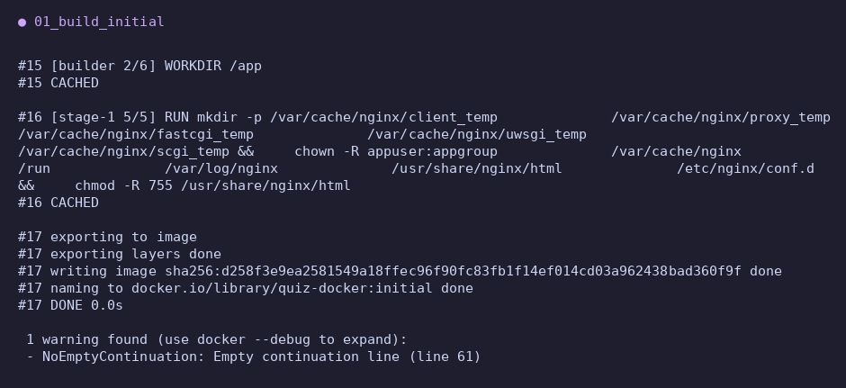

### Capture : utilisateur du processus

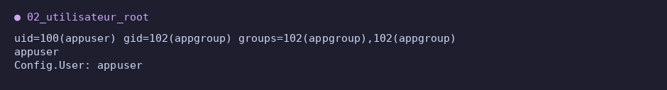

### Capture : taille et couches

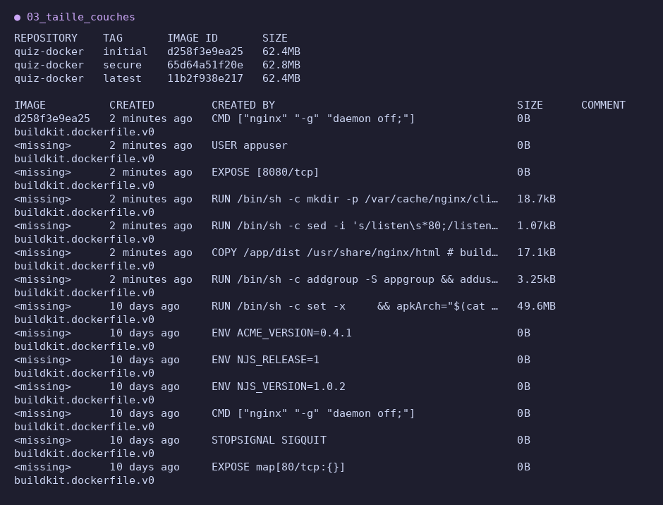

### Capture : scan CVE initial

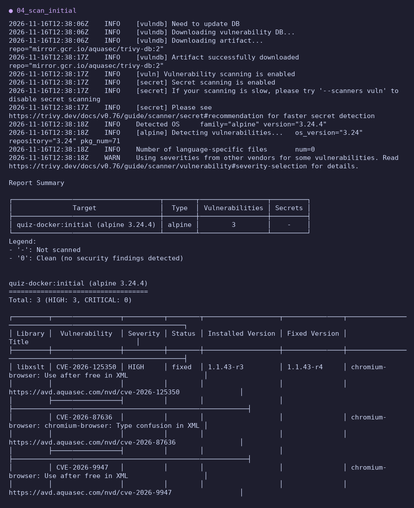

### Capture : test fonctionnel (HTTP 200)

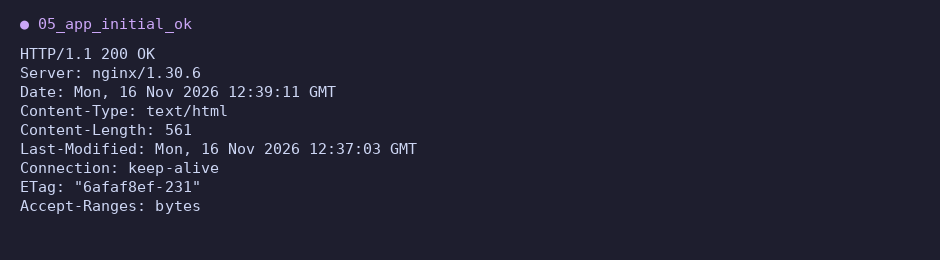

### L'image est-elle prête pour la production ?

Non. Trois CVE HIGH dans `libxslt` ont un correctif disponible mais non appliqué. Les tags ne sont pas épinglés par digest (builds non reproductibles, risque de mutation de tag). Il manque un healthcheck et des en-têtes HTTP de sécurité.

### Composants nécessaires à l'exécution

L'application est un site statique compilé par Vite (HTML + CSS + JS, < 25 KB). En production, seuls deux éléments sont nécessaires : les fichiers `dist/` et nginx. Node.js, npm et `node_modules` ne sont utilisés qu'au build — le multi-stage build existant les exclut déjà de l'image finale.

### Risques identifiés

| # | Risque | Sévérité | Détail |
|---|---|---|---|
| 1 | CVE dans libxslt | HIGH | 3 CVE (CVE-2026-125350, CVE-2026-87636, CVE-2026-9947) — use-after-free et type confusion dans libxslt 1.1.43-r3. Correctif : r4. |
| 2 | Tags flottants | MOYENNE | `nginx:stable-alpine` sans digest SHA256 : un attaquant contrôlant le registry peut substituer une image. |
| 3 | Pas de HEALTHCHECK | FAIBLE | Docker ne détecte pas une application bloquée pour la redémarrer. |
| 4 | Pas d'en-têtes HTTP sécurité | FAIBLE | Absence de `X-Frame-Options`, `X-Content-Type-Options`, etc. Facilite le clickjacking et le sniffing. |
| 5 | Version nginx exposée | FAIBLE | `server_tokens` non désactivé : `Server: nginx/1.30.6` dans toutes les réponses. |
| 6 | .dockerignore incomplet | FAIBLE | Fichiers `.env`, `*.pem`, `*.key` non exclus explicitement. |
| 7 | Pas de limites runtime | VARIABLE | Sans `--cap-drop`, `--read-only`, `--memory`, un conteneur compromis peut épuiser les ressources de l'hôte. |

### Améliorations prioritaires

1. Patcher libxslt (CVE connues avec correctif disponible)
2. Épingler les images par digest SHA256
3. Appliquer les limites runtime (`--cap-drop ALL`, `--read-only`, `--memory`, `--cpus`)
4. Ajouter HEALTHCHECK et en-têtes HTTP de sécurité

---

## Mission 2 — Durcissement de l'image et du conteneur

### Mesures appliquées

| Mesure | Justification |
|---|---|
| Digest SHA256 épinglé sur toutes les images de base | Immunise contre la mutation de tag et garantit la reproductibilité des builds |
| `apk upgrade --no-cache libxslt` | Corrige les 3 CVE HIGH (r3→r4) sans augmenter la surface d'attaque |
| UID/GID fixes à 1001, `-H -s /sbin/nologin` | UID déterministe entre hôtes ; aucun shell ni home disponibles à l'attaquant |
| `npm ci --ignore-scripts` | Empêche l'exécution de scripts npm arbitraires (protection supply-chain) |
| `nginx.conf` dédié avec `server_tokens off` | Masque la version nginx ; configuration minimale sans modules inutiles |
| En-têtes HTTP : `X-Frame-Options`, `X-Content-Type-Options`, `X-XSS-Protection`, `Referrer-Policy`, `Permissions-Policy` | Protège les utilisateurs finaux contre le clickjacking, le sniffing et la fuite de référents |
| `COPY` exclusivement (pas d'`ADD`) | `ADD` avec URL distante est non auditable au moment du build |
| `HEALTHCHECK` intégré | Docker peut détecter et redémarrer un conteneur silencieusement bloqué |
| `.dockerignore` étendu (`.env*`, `*.pem`, `*.key`, IDE, logs, Dockerfiles) | Empêche la copie accidentelle de secrets dans le contexte de build |
| `--cap-drop ALL` | Supprime toutes les capabilities Linux — l'application n'en a besoin d'aucune |
| `--security-opt no-new-privileges:true` | Empêche le processus d'acquérir de nouveaux privilèges via setuid/setgid |
| `--read-only` + `--tmpfs` | Système de fichiers en lecture seule ; seuls `/var/cache/nginx`, `/run` et `/tmp` sont montés en tmpfs |
| `--memory=64m --cpus=0.5 --pids-limit=50` | Plafonne la consommation de ressources ; empêche un DoS par épuisement |
| Pas de montage de `/var/run/docker.sock` | Monter le socket Docker revient à donner un accès root à l'hôte |

### Capture : build sécurisé

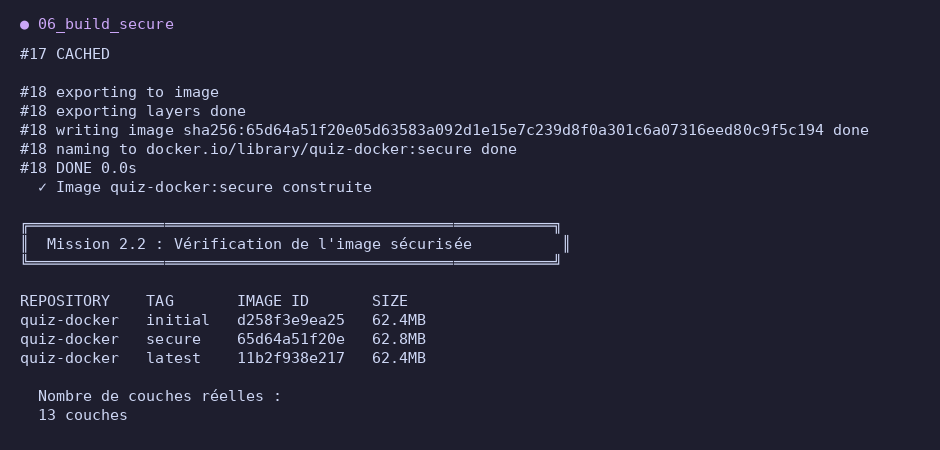

### Capture : run avec limites

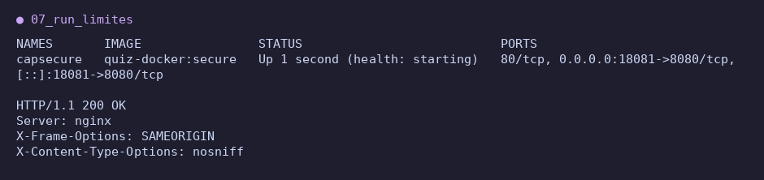

### Capture : inspection HostConfig

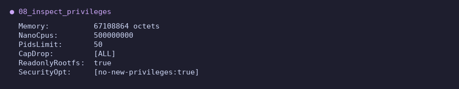

---

## Mission 3 — Comparaison avant/après

### Tableau comparatif complet

| Critère | `quiz-docker:initial` | `quiz-docker:secure` |
|---|---|---|
| **Image de base** | `nginx:stable-alpine` (tag) | `nginx:stable-alpine@sha256:901e59…` (digest) |
| **Taille** | 62,4 MB | 62,8 MB (+0,4 MB = patch libxslt) |
| **Couches réelles** | 12 | 13 |
| **Utilisateur** | appuser uid=100 | appuser uid=1001 (fixe, sans shell ni home) |
| **Outils de dev dans l'image finale** | ✗ (multi-stage) | ✗ (multi-stage) |
| **Digest épinglé** | ✗ | ✓ |
| **multi-stage build** | ✓ | ✓ |
| **npm --ignore-scripts** | ✗ | ✓ |
| **HEALTHCHECK** | ✗ | ✓ |
| **server_tokens off** | ✗ | ✓ |
| **En-têtes HTTP sécurité** | ✗ | ✓ (5 en-têtes) |
| **.dockerignore** | 4 règles | 20+ règles |
| **CVE CRITICAL** | 0 | **0** |
| **CVE HIGH** | **3** | **0** ✅ |
| **CVE MEDIUM** | 2 | 1 |
| **CVE LOW** | 0 | 0 |
| **Limites runtime (memory/CPU/pids)** | ✗ | ✓ (64m / 0.5 / 50) |
| **--cap-drop ALL** | ✗ | ✓ |
| **--security-opt no-new-privileges** | ✗ | ✓ |
| **--read-only** | ✗ | ✓ |
| **Montage /var/run/docker.sock** | ✗ | ✗ |

### Capture : scan sécurisé (0 CVE HIGH/CRITICAL)

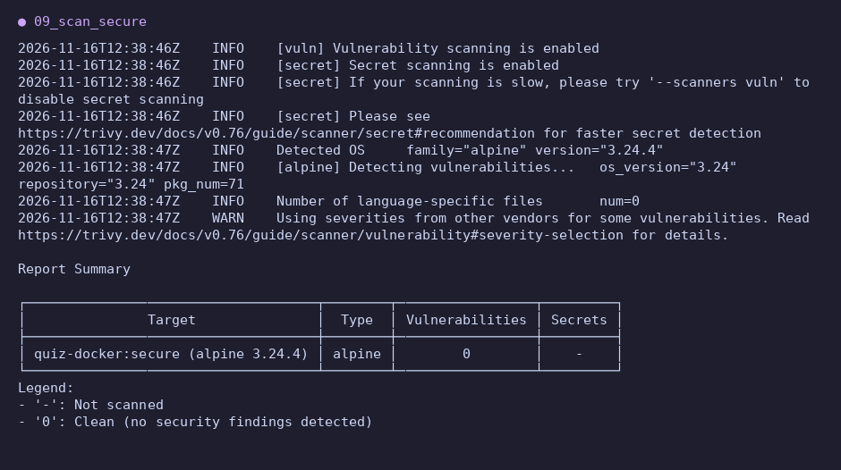

### Capture : comparaison des tailles

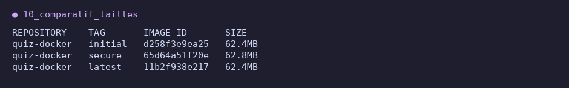

### Analyse

L'image sécurisée est légèrement plus lourde (+0,4 MB) car elle inclut le patch `apk upgrade libxslt`. Ce surcoût est justifié : il élimine 3 CVE HIGH. Le nombre de couches passe de 12 à 13 pour la même raison.

Le vrai gain est qualitatif : les 7 risques identifiés en Mission 1 sont tous traités. Le seul CVE MEDIUM restant dans l'image sécurisée est hors portée de ce TP (il ne concerne pas libxslt et n'a pas de correctif disponible dans le package manager Alpine à la date du scan).

---

## Mission 4 — Docker Hardened Image (DHI)

L'image de référence utilisée est `cgr.dev/chainguard/nginx:latest` (Chainguard), une image distroless basée sur Wolfi OS — le pendant public des Docker Hardened Images du programme officiel Docker.

### Comparaison DHI vs image sécurisée

| Critère | `quiz-docker:secure` | `cgr.dev/chainguard/nginx:latest` |
|---|---|---|
| **Base OS** | Alpine 3.24.4 | Wolfi (distroless) |
| **Taille** | 62,8 MB | **19,6 MB** |
| **Shell disponible** | ✗ (/sbin/nologin) | ✗ (distroless, pas de /bin/sh) |
| **CVE HIGH/CRITICAL** | 0 | 0 |
| **Package manager dans l'image** | ✗ (apk supprimé par Alpine) | ✗ |
| **Signé (Sigstore/cosign)** | ✗ | ✓ |
| **SBOM inclus** | ✗ | ✓ |
| **Utilisateur runtime** | uid=1001 | uid=65532 (nonroot) |

### Capture : scan DHI

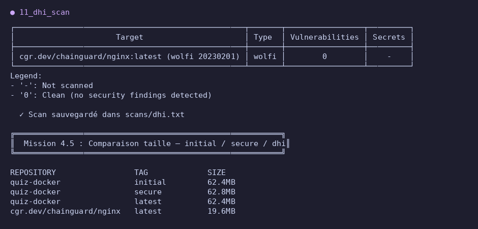

### Analyse

La DHI Chainguard est 3× plus légère (19,6 MB vs 62,8 MB) car l'OS Wolfi n'embarque que les binaires strictement nécessaires à nginx — pas de BusyBox, pas d'init, pas d'utilitaires système. L'absence totale de shell empêche toute exécution de commandes interactives même si un attaquant obtient un accès. Elle est également signée via Sigstore, permettant de vérifier cryptographiquement son intégrité avant tout déploiement.

Le principal inconvénient est la dépendance à un registry tiers (`cgr.dev`) et à une chaîne de mise à jour gérée par Chainguard. Pour un déploiement en production, il faudra évaluer la politique de support et les SLA du fournisseur.

---

## Mission 5 — Publication

### Docker Hub

```bash
# Connexion avec token (jamais le mot de passe en clair)
echo "$DOCKERHUB_TOKEN" | docker login -u lcgregorio93 --password-stdin

docker tag quiz-docker:initial lcgregorio93/quiz-docker:initial
docker tag quiz-docker:secure  lcgregorio93/quiz-docker:secure

docker push lcgregorio93/quiz-docker:initial
docker push lcgregorio93/quiz-docker:secure
```

### GitHub

```bash
git init && git branch -M main
git add . && git commit -m "TP Docker : sécurisation image et conteneur"
# gh CLI non disponible — push manuel :
git remote add origin https://github.com/lcgregorio93/tp-docker-securisation.git
git push -u origin main
```

### Capture : push Docker Hub

> 📸 **Capture 12** — à effectuer manuellement après `docker push` :  
> `screenshots/12_push_dockerhub.png`

### Capture : pull public

> 📸 **Capture 13** — à effectuer après `docker logout` pour prouver l'accessibilité publique :  
> ```bash
> docker logout
> docker pull lcgregorio93/quiz-docker:secure
> ```
> `screenshots/13_pull_public.png`

### Capture : page GitHub

> 📸 **Capture 14** — capture navigateur de https://github.com/lcgregorio93/tp-docker-securisation  
> `screenshots/14_github_repo.png`

---

## Synthèse finale

### Améliorations apportées

| Catégorie | Avant | Après |
|---|---|---|
| **Vulnérabilités HIGH** | 3 (libxslt) | 0 |
| **Reproductibilité** | Tags flottants | Digests SHA256 épinglés |
| **Isolation runtime** | Aucune | cap-drop ALL + read-only + no-new-privs |
| **Limites de ressources** | Aucune | 64 MB RAM, 0,5 CPU, 50 PIDs |
| **En-têtes HTTP** | Absents | 5 en-têtes de protection |
| **Configuration nginx** | sed en place | Fichier dédié, server_tokens off |
| **Exclusions build** | 4 règles | 20+ règles (.env, clés, IDE) |

### Risques résiduels

| Risque | Nature | Mitigation suggérée |
|---|---|---|
| **1 CVE MEDIUM (libxslt)** | Pas de correctif Alpine disponible à la date du scan | Surveiller les mises à jour Alpine ; reconstruire régulièrement |
| **Image non signée** | Impossible de vérifier l'intégrité cryptographique de l'image | Adopter Sigstore/cosign (`cosign sign`) dans la CI/CD |
| **Pas de SBOM** | Inventaire des composants absent | Générer via `syft` ou `trivy sbom` à chaque build |
| **Supply chain npm** | `vite@4.4.5` présente 6 vulnérabilités npm (audit) | Mettre à jour vite vers une version sans CVE ; activer Dependabot |
| **Dépendance à des registries tiers** | `cgr.dev`, `aquasec/trivy` | Utiliser un registry miroir interne en production |
| **Rotation des secrets** | `DOCKERHUB_TOKEN` stocké en variable d'environnement locale | Utiliser un gestionnaire de secrets (Vault, AWS Secrets Manager) |
| **Mises à jour de l'image de base** | `nginx:stable-alpine` publie des patches régulièrement | Automatiser la reconstruction via un pipeline CI/CD (GitHub Actions, Renovate) |
| **Monitoring runtime** | Aucune supervision des conteneurs en production | Intégrer Falco ou Sysdig pour la détection d'anomalies comportementales |

### Commandes de reproduction

```bash
# Cloner et reconstruire from scratch
git clone https://github.com/lcgregorio93/tp-docker-securisation.git
cd tp-docker-securisation

# Audit + build + scan + captures
bash scripts/01_audit_initial.sh
bash scripts/02_build_secure.sh
bash scripts/03_run_secure.sh
bash scripts/04_scan_compare.sh
bash scripts/05_dhi.sh
bash scripts/capture_all.sh

# Publication (tokens requis)
export DOCKERHUB_TOKEN="<votre_token_dockerhub>"
bash scripts/06_publish.sh
```
